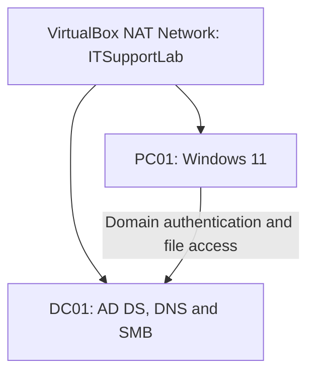
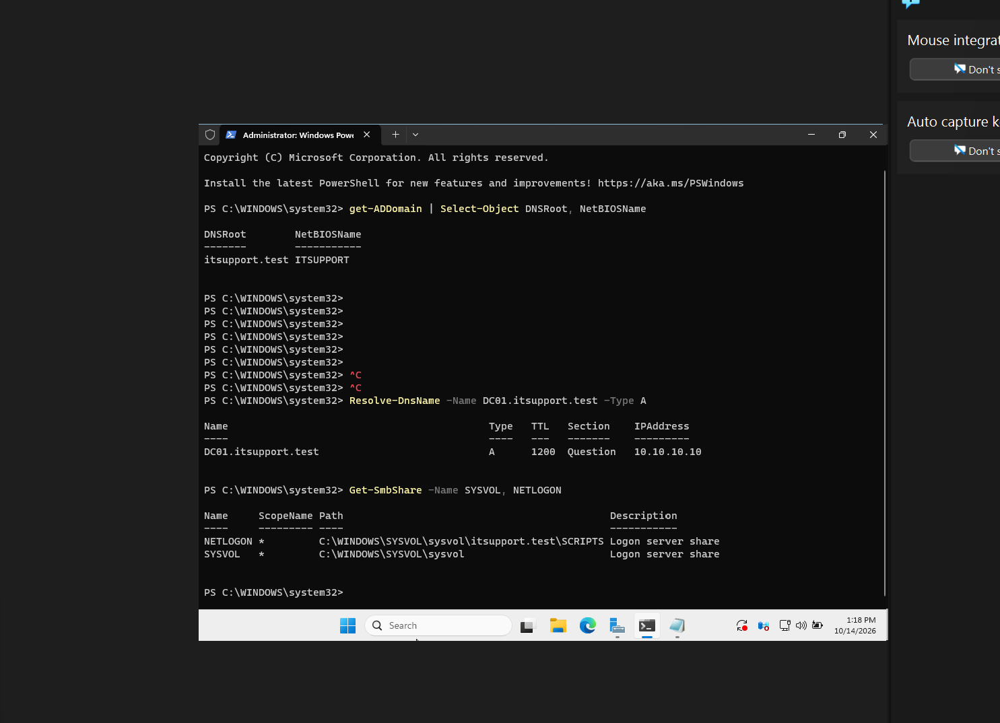
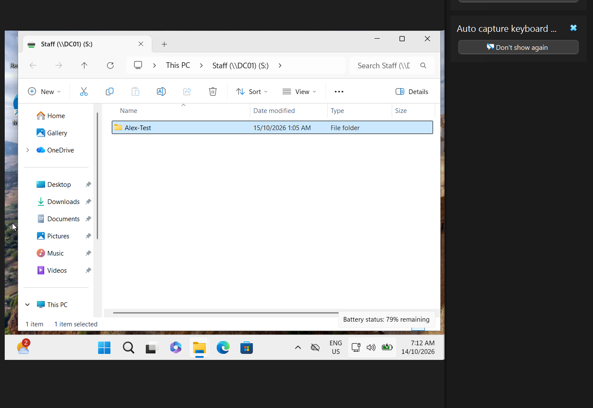

# Windows IT Support Lab

Personal home lab by Tanmoy Bhowmick, built to practise Windows desktop support and Active Directory administration. This is a simulated small-business environment, not paid employment or a production deployment.

## Current progress — 14 October 2026

| Feature | Status and evidence |
|---|---|
| Windows Server 2025 domain controller DC01 | Installed and promoted; domain/DNS/SYSVOL checks captured |
| Windows 11 Enterprise client PC01 | Installed; domain sign-in confirmed by user |
| Static addressing and DNS | DC01 verified; PC01 configured during walkthrough |
| OUs and employee accounts | OUs and Alex membership captured; Priya setup reported complete |
| Staff SMB share and S: drive | Access confirmed; mapped drive and Alex-Test folder captured |
| Finance share | Access reported working; screenshot shows share open. Separate write and Alex denial evidence still to capture |
| Group Policy automatic lock | Planned; deferred, not implemented or verified |
| Help desk portfolio | Initial lab incident records documented; ticketing platform not installed |

## Environment

| Machine | Role | IP | DNS |
|---|---|---|---|
| DC01 | AD DS and DNS; lab SMB shares | 10.10.10.10/24 | 10.10.10.10 |
| PC01 | Windows 11 employee workstation | 10.10.10.20/24 | 10.10.10.10 |

VirtualBox NAT Network: `ITSupportLab`; network `10.10.10.0/24`; gateway `10.10.10.1`. Domain: `itsupport.test`; NetBIOS: `ITSUPPORT`. Evaluation operating systems are used for learning.

## What this demonstrates

- Creating a domain and joining a workstation.
- Managing employee accounts and nested security groups.
- Configuring SMB shares and NTFS permissions.
- Testing access as ordinary users and troubleshooting access denied.
- Mapping a network drive and documenting support incidents.

## Documentation

- [Setup record](docs/setup.md)
- [Access control and test matrix](docs/access-control.md)
- [Evidence index](docs/evidence.md)
- [Resume checklist](docs/resume-checklist.md)
- [CV project entry](docs/cv-entry.md)
- [Lab tickets](tickets/README.md)

## Evidence

## Scope and limitations

The domain controller also hosts file shares to keep this learning lab small. Only one client and one domain controller are used. There is no high availability or production hardening claim. Screenshots establish only what they display; user-reported results are labelled in the test matrix. Troubleshooting root causes were not always recorded, so they are not invented here.

Do not commit passwords, recovery secrets, ISO images, virtual disks or VM snapshots. Windows evaluation expiry should be checked before resuming after a long break.

